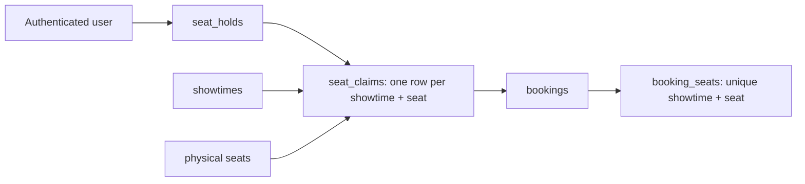

# SeatLock

SeatLock is a portfolio movie-ticket application with PostgreSQL-backed authentication, seat availability, five-minute holds, and confirmed demo bookings. No real payment is processed.

## PostgreSQL development setup

Use a local PostgreSQL 17 database or Docker Desktop with Compose. Copy `.env.example` to `.env`, then set a unique local password in both `POSTGRES_PASSWORD` and `DATABASE_URL`. The `.env` file is ignored by Git. Never commit credentials.

```sh
docker compose up -d --wait
npm install
npm install --prefix backend
npm install --prefix frontend
npm run migrate --prefix backend
npm run seed --prefix backend
npm run dev
```

The database is stored in the persistent `seatlock_pgdata` Docker volume. Migrations are numbered SQL files in `backend/migrations`; the runner records applied versions in `schema_migrations` and runs each migration in a transaction. Migration 002 adds `auth_sessions`; migration 003 adds the booking engine. The development seed inserts four sample movies, showtimes, screens, and 40 physical seats per screen. Rerunning it preserves existing rows. Restarting the backend does not erase database rows. If port 5432 is occupied, change both `POSTGRES_PORT` and the port in `DATABASE_URL` in `.env` (this machine uses 55432).

The API runs at <http://127.0.0.1:4000> and the Vite frontend at <http://127.0.0.1:5173>. Use the IPv4 URL if another local service owns the IPv6 `localhost` listener. `GET /api/health` checks the database connection. A database outage returns an error; the API never falls back to in-memory sample data.

### API endpoints

- `GET /api/health` — service and database status.
- `GET /api/movies` — movies with showtimes.
- `GET /api/movies/:id` — one movie with showtimes, or 404.
- `GET /api/showtimes?movieId=afterlight` — showtimes for one movie.
- `GET /api/showtimes/:id/seats` — auditorium and physical seat layout for a showtime, or 404.
- `POST /api/auth/register` — create a user and session; `{name,email,password}`.
- `POST /api/auth/login` — sign in; `{email,password}`.
- `POST /api/auth/logout` — destroy the current session.
- `GET /api/auth/me` — current user, or 401.
- `GET /api/showtimes/:id/availability` — public seat statuses: `available`, `held`, or `booked`.
- `POST /api/holds` — authenticated hold for `{showtimeId,seatIds}` (1–6 seat ID strings).
- `GET /api/holds/:id` — current user's hold and expiry.
- `DELETE /api/holds/:id` — release the current user's hold.
- `POST /api/holds/:id/confirm` — idempotent demo confirmation, with no payment.
- `GET /api/bookings` — current user's booking history.
- `GET /api/bookings/:id` — current user's booking details.

### Booking architecture



`seat_holds` records ownership, expiry, seat count, and a server-calculated unit price. `seat_claims` has a primary key on `(showtime_id, seat_id)`. A hold request runs in one PostgreSQL transaction, checks auditorium membership, sorts seat IDs, and acquires each claim. Its conflict update succeeds only when the previous claim is a hold whose expiry is at or before PostgreSQL `clock_timestamp()`. If any seat conflicts, the transaction rolls back every claim in the group. Expired claims can therefore be reused without a cleanup worker.

Confirmation locks the hold row, checks ownership and database expiry, and creates a booking, booking-seat price snapshots, and permanent booked claims in one transaction. `bookings.hold_id` is unique, making repeat confirmations return the existing booking. `booking_seats` independently enforces unique `(showtime_id, seat_id)` allocations. Foreign keys tie seats and showtimes to the same auditorium. A booked claim cannot be replaced by a hold. Booking references are unique random values. No payment authorization or charge occurs.

The frontend polls availability every eight seconds while selecting seats. A successful hold displays its server-calculated total and a countdown. The database remains authoritative if the client's clock or seat view is stale. Confirmed demo bookings appear in the account dashboard.

### Session security

Passwords use Argon2id hashes. The browser receives an opaque, random session cookie (`seatlock.sid`) with `HttpOnly`, `SameSite=Lax`, and a seven-day expiry. The cookie has `Secure` set when `NODE_ENV=production`; production must be served over HTTPS. Only a SHA-256 hash of the session token is stored in PostgreSQL, tied to a user and expiry time. Login replaces any presented session, and logout deletes it. No auth token is placed in localStorage.

All auth and booking state-changing routes require an exact `Origin` match with `FRONTEND_ORIGIN` and the `X-SeatLock-Request: 1` header. The frontend sends these through the same-origin Vite proxy. Set `FRONTEND_ORIGIN` to the deployed origin in production. Login is limited to ten attempts per IP per fifteen minutes per server process; use a shared limiter if deploying multiple API instances. Error responses omit hashes and internal details.

### Checks

```sh
npm run typecheck
npm run build
npm run migrate --prefix backend
npm run seed --prefix backend
npm run test:integration --prefix backend
npm run test:auth --prefix backend
npm run test:booking --prefix backend
```

In a PostgreSQL-backed test run, two concurrent users produced **one hold and one conflict** for one seat. Twenty parallel hold requests produced **one hold and nineteen conflicts**. Twenty parallel hold-to-confirm workflows produced **one confirmed booking and nineteen conflicts** for one physical seat. Two concurrent confirmations of a multi-seat hold produced **two successful idempotent responses, one booking row, and two booked seat rows**. The test also checks overlapping groups, rollback, expiry reuse, authorization, price totals, and private history. Re-run the command above on your own database; these are recorded results, not a guarantee for an untested deployment.

Current limitations: bookings are demo confirmations with no payment, cancellation, refunds, notifications, or Socket.IO. Availability updates through polling; Redis is not required for correctness. The login rate limiter is process-local. Deploy the frontend and API behind one HTTPS origin and keep PostgreSQL migrations and credentials managed securely.
