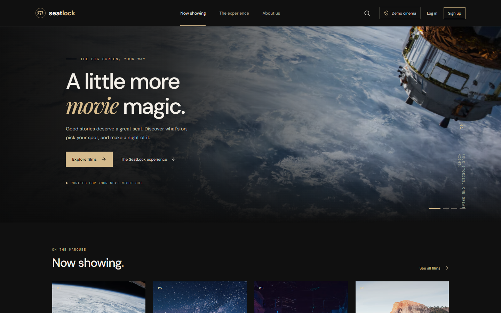
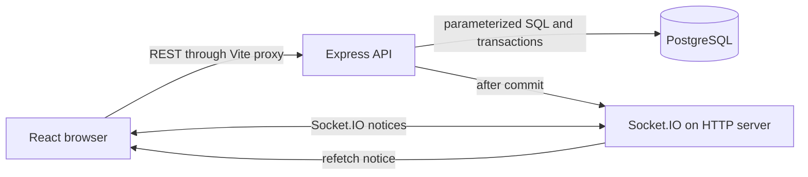
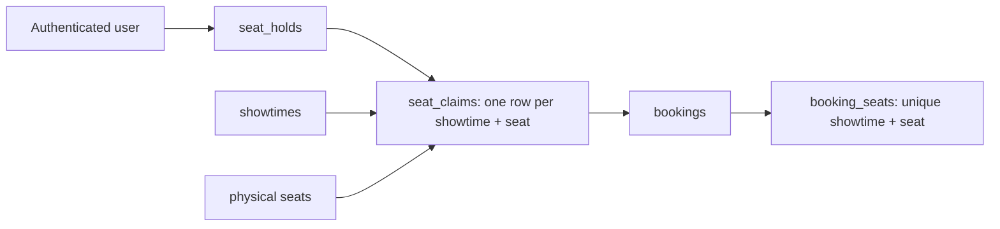

# SeatLock

**A movie ticket booking portfolio application built around a PostgreSQL seat claim.** SeatLock lets visitors browse sample films, sign in, hold seats for five minutes, and complete a **demo confirmation with no payment charged**. Socket.IO keeps two browsers informed while PostgreSQL decides who owns each seat.

## The problem

A seat can look available in two browsers at once. A reliable checkout must settle that race on the server, make multi-seat requests atomic, and keep confirmed seats unavailable even when notifications arrive late. SeatLock is an inspectable implementation of that workflow.

## Key features

- Responsive film catalog, showtime details, keyboard-accessible seat picker, account dashboard, and mobile navigation.
- PostgreSQL-backed registration, Argon2id password hashes, and persistent server-side sessions.
- Five-minute holds for up to six seats with release, expiry, refresh restoration, and server-calculated totals.
- Idempotent demo booking confirmation, booking references, price snapshots, and user-specific history.
- Showtime-specific Socket.IO notifications with database reconciliation after reconnect.
- Automated API, authentication, booking concurrency, real-time, and Edge browser tests.

The four seeded films, showtimes, theaters, and prices are **sample data**. There is no real cinema inventory or payment processing.

## Screenshots

These are captures of the running app using Edge and isolated fictional test data. The test removes its own database fixtures afterward.

| Browse | Reserve | Confirm |
| --- | --- | --- |
| [Homepage](docs/screenshots/01-homepage.png) | [Showtimes](docs/screenshots/03-showtimes.png) | [Demo confirmation](docs/screenshots/05-demo-confirmation.png) |
| [Movie catalog](docs/screenshots/02-movie-catalog.png) | [Seat selection](docs/screenshots/04-seat-selection.png) | [Dashboard](docs/screenshots/06-dashboard.png) |



## Technology and system architecture

| Layer | Technology | Role |
| --- | --- | --- |
| Frontend | React 19, TypeScript, Vite | Catalog, authentication, seat picker, dashboard |
| API | Node.js, Express 5, TypeScript | Validation, sessions, booking transactions, REST endpoints |
| Database | PostgreSQL 17, `pg`, versioned SQL migrations | Users, sessions, films, physical seats, claims, bookings |
| Real time | Socket.IO | Room-scoped change notices after database commits |
| Tests | Node test runner, Playwright with Edge | Integration, concurrency, two-user browser workflow |



The frontend fetches authoritative data from the API. Socket events tell browsers when to refetch; they do not grant seat ownership. `users` own `auth_sessions`, `seat_holds`, and `bookings`. `movies` have `showtimes`; each showtime uses one `auditorium`, which owns physical `seats`. `seat_claims` has one row per showtime and seat, and `booking_seats` stores the booking-time price. Composite foreign keys require claimed seats to belong to the showtime's auditorium. See the numbered SQL files in `backend/migrations`.

## Deployment preparation

The production build serves React, `/api`, and Socket.IO from one Express origin. A single Railway app service with a private PostgreSQL service is the proposed hosting shape; **nothing has been deployed**. See [the deployment guide](docs/DEPLOYMENT.md) for commands, variables, TLS and cookie settings, backups, recovery, costs, and remaining verification. The existing Vite proxy remains the local development path.

## PostgreSQL development setup

Requirements: Node.js and npm, PostgreSQL 17 (local or Docker Desktop with Compose), and Microsoft Edge only for the included browser test. No API keys or paid services are needed. Copy `.env.example` to `.env`, then set a unique local password in both `POSTGRES_PASSWORD` and `DATABASE_URL`. The `.env` file is ignored by Git. Never commit credentials or use the example placeholder in a deployed environment.

```sh
docker compose up -d --wait
npm ci
npm ci --prefix backend
npm ci --prefix frontend
npm run migrate --prefix backend
npm run seed --prefix backend
npm run dev
```

The database is stored in the persistent `seatlock_pgdata` Docker volume. Migrations are numbered SQL files in `backend/migrations`; the runner records applied versions in `schema_migrations` and runs each migration in a transaction under a database advisory lock. Migration 002 adds `auth_sessions`; migration 003 adds the booking engine. The development seed inserts four sample movies, screens, 40 physical seats per screen, and two future UTC days of demo showtimes. Rerunning it preserves existing rows. With `DEMO_MODE=true`, the server replenishes future demo dates every six hours without deleting history. Restarting the backend does not erase database rows. If port 5432 is occupied, change both `POSTGRES_PORT` and the port in `DATABASE_URL` in `.env` (this machine uses 55432).

The default API URL is <http://127.0.0.1:4000> and the default Vite frontend URL is <http://127.0.0.1:5173>. Check that both ports are free before using `npm run dev`; Vite may otherwise select a different port, which must also match `FRONTEND_ORIGIN`. On this machine port 5173 is occupied by an unrelated app, so a SeatLock preview was started at <http://127.0.0.1:52119> with its API at <http://127.0.0.1:42119>. Use these PowerShell commands in separate terminals after `npm run build` to reproduce that setup:

```powershell
# Terminal 1, from S:\SeatLock
$env:PORT = '42119'
$env:FRONTEND_ORIGIN = 'http://127.0.0.1:52119'
npm run start --prefix backend

# Terminal 2, from S:\SeatLock\frontend
$env:SEATLOCK_API_TARGET = 'http://127.0.0.1:42119'
node node_modules/vite/bin/vite.js --host 127.0.0.1 --port 52119 --strictPort
```

### Environment variables

| Variable | Purpose |
| --- | --- |
| `POSTGRES_USER`, `POSTGRES_PASSWORD`, `POSTGRES_DB`, `POSTGRES_PORT` | Docker PostgreSQL configuration |
| `DATABASE_URL` | Backend PostgreSQL connection string |
| `PORT` | API port, default `4000` |
| `FRONTEND_ORIGIN` | Exact browser origin trusted for CORS, state changes, and Socket.IO |
| `NODE_ENV` | Set to `production` behind HTTPS to enable Secure cookies |
| `SEATLOCK_API_TARGET` | Vite development proxy target, default `http://127.0.0.1:4000` |
| `DEMO_MODE` | Use `true` for a rolling fictional schedule in the portfolio deployment |
| `DATABASE_SSL_MODE`, `DATABASE_CA_CERT` | Optional PostgreSQL TLS verification settings; see the deployment guide |

`GET /api/health` checks the database connection. A database outage returns an error; the API never falls back to in-memory sample data.

### API endpoints

- `GET /api/health` — service and database status.
- `GET /api/movies` — movies with showtimes.
- `GET /api/movies/:id` — one movie with showtimes, or 404.
- `GET /api/showtimes?movieId=afterlight` — showtimes for one movie.
- `GET /api/showtimes/:id/seats` — auditorium and physical seat layout for a showtime, or 404.
- `POST /api/auth/register` — create a user and session; `{name,email,password}`.
- `POST /api/auth/login` — sign in; `{email,password}`.
- `POST /api/auth/logout` — destroy the current session.
- `GET /api/auth/me` — current user, or 401.
- `GET /api/showtimes/:id/availability` — public seat statuses: `available`, `held`, or `booked`.
- `POST /api/holds` — authenticated hold for `{showtimeId,seatIds}` (1–6 seat ID strings).
- `GET /api/holds/:id` — current user's hold and expiry.
- `DELETE /api/holds/:id` — release the current user's hold.
- `POST /api/holds/:id/confirm` — idempotent demo confirmation, with no payment.
- `GET /api/bookings` — current user's booking history.
- `GET /api/bookings/:id` — current user's booking details.

### Booking architecture



`seat_holds` records ownership, expiry, seat count, and a server-calculated unit price. `seat_claims` has a primary key on `(showtime_id, seat_id)`. A hold request runs in one PostgreSQL transaction, checks auditorium membership, sorts seat IDs, and acquires each claim. Its conflict update succeeds only when the previous claim is a hold whose expiry is at or before PostgreSQL `clock_timestamp()`. If any seat conflicts, the transaction rolls back every claim in the group. Expired claims can therefore be reused without a cleanup worker.

Confirmation locks the hold row, checks ownership and database expiry, and creates a booking, booking-seat price snapshots, and permanent booked claims in one transaction. `bookings.hold_id` is unique, making repeat confirmations return the existing booking. `booking_seats` independently enforces unique `(showtime_id, seat_id)` allocations. Foreign keys tie seats and showtimes to the same auditorium. A booked claim cannot be replaced by a hold. Booking references are unique random values. No payment authorization or charge occurs.

The frontend polls availability every eight seconds while selecting seats. A successful hold displays its server-calculated total and a countdown. The database remains authoritative if the client's clock or seat view is stale. Confirmed demo bookings appear in the account dashboard.

The seat hold lifecycle is create → active for up to five minutes → released, expired, or confirmed. Confirmation stores booking-time seat prices and a unique reference. Repeat confirmation of the same hold returns the existing booking. All booking writes use short transactions with rollback on failure. **Demo Confirmation — No Payment Charged** is a portfolio workflow, not a purchase.

### Real-time availability

Socket.IO runs on the existing Express HTTP server. Clients join a validated `showtime:<id>` room with `showtime:join` and leave with `showtime:leave`. The server checks that the showtime exists and accepts connections only from `FRONTEND_ORIGIN`. Clients cannot publish authoritative availability events.

After a successful PostgreSQL commit, the server emits **`availability:changed`** to that showtime room:

```json
{ "showtimeId": "a1", "reason": "hold_created", "changedAt": "2026-11-13T12:00:00.000Z" }
```

`reason` is one of `hold_created`, `hold_released`, or `booking_confirmed`. The event carries no seat ownership, session token, user details, or booking details. It is a notification only: clients refetch `GET /api/showtimes/:id/availability`, and PostgreSQL remains the source of truth. The UI ignores notices for other showtimes and applies only the latest availability response, so duplicate or delayed notices cannot overwrite a newer fetch. Reconnection rejoins the room and refetches immediately. An eight-second poll reconciles missed events and hold expiry, which can occur without a database write or Socket.IO event.

An active hold ID, movie ID, and showtime ID are kept in browser `sessionStorage` solely to reopen the modal after a page refresh; the ID grants no authority without the user's HTTP-only session cookie. On restoration and every ten seconds while held, the UI checks `GET /api/holds/:id`. The countdown uses the backend's `expiresAt` and `serverTime`, disables confirmation at zero, and checks the hold again before confirmation. The backend's transaction makes the final decision if the browser clock or network is stale.

### Session security

Passwords use Argon2id hashes. The browser receives an opaque, random session cookie (`seatlock.sid`) with `HttpOnly`, `SameSite=Lax`, and a seven-day expiry. The cookie has `Secure` set when `NODE_ENV=production`; production must be served over HTTPS. Only a SHA-256 hash of the session token is stored in PostgreSQL, tied to a user and expiry time. Login replaces any presented session, and logout deletes it. No auth token is placed in localStorage.

All auth and booking state-changing routes require an exact `Origin` match with `FRONTEND_ORIGIN` and the `X-SeatLock-Request: 1` header. Vite proxies these locally; Express serves the frontend on the same origin in production. Set `FRONTEND_ORIGIN` to the exact deployed HTTPS origin. Login is limited to ten attempts and registration to five attempts per IP per fifteen minutes per server process; use a shared limiter if deploying multiple API instances. Error responses omit hashes and internal details.

In production, Express trusts one proxy hop. Deploy behind exactly one trusted reverse proxy or review that setting. The session store is PostgreSQL and is not tied to the API process lifetime. These controls have automated coverage, but they are not a production security certification.

### Checks

```sh
npm run typecheck
npm run build
npm run migrate --prefix backend
npm run seed --prefix backend
npm run test:integration --prefix backend
npm run test:auth --prefix backend
npm run test:booking --prefix backend
npm run test:realtime --prefix backend
npm run test:e2e
npm audit
npm audit --prefix backend
npm audit --prefix frontend
```

The Edge browser test starts its own SeatLock servers on ports 42117 and 52117, avoiding unrelated services on the usual development ports. It uses isolated movie, showtime, seat, and account fixtures and removes only those fixtures afterward. Set `CAPTURE_SCREENSHOTS=true` when deliberately refreshing the six portfolio screenshots; ordinary test runs leave them untouched. The test requires the installed Microsoft Edge browser; change `playwright.config.cjs` to another Playwright browser channel if needed. CI runs database-backed Node tests, typechecks, and build; browser E2E remains a local check. For manual testing: register two accounts in separate browser profiles, open the same showtime, hold a seat in one, confirm the other sees it held, release it, then confirm a demo booking and check both seat views and account history. Refresh while a hold is active to verify restoration, then disconnect and reconnect the network to verify recovery.

**Recorded on 2026-11-13 against a local PostgreSQL 17 container:** backend and frontend typechecks and production build passed; API **4/4**, auth **9/9**, booking **7/7**, real-time **5/5**, Edge E2E **2/2** passed. Two concurrent users produced **one hold and one conflict** for one seat. Twenty parallel hold requests produced **one hold and nineteen conflicts**. Twenty parallel hold-to-confirm workflows produced **one confirmed booking and nineteen conflicts** for one physical seat. Two concurrent confirmations of a multi-seat hold produced **two successful idempotent responses, one booking row, and two booked seat rows**. Real-time tests verified that two clients receive committed hold and release notices, an unrelated room receives none, a reconnecting client refetches booked state, and expiry is visible without an event. The Edge test covered registration, live seat changes, release, refresh restoration, confirmation, history, logout/login, and network reconnect. These are recorded test results, not throughput benchmarks or a guarantee for an untested deployment.

Phase 5B-2 preparation reran the checks against a disposable database: API **4/4**, auth **9/9**, booking **8/8**, real-time **5/5**, and Edge E2E **2/2** passed. The additional booking test rejects holds and confirmations after a showtime starts. The clean deployment build and a local production-mode HTTP/Socket.IO smoke test also passed. See [deployment verification details](docs/DEPLOYMENT.md#local-verification-without-cloud-resources). No public HTTPS deployment has been tested.

## Current limitations and future work

Bookings are demo confirmations with no payment, ticket scanning, cancellation, refunds, or customer notifications. There is no email verification, password reset, operational monitoring, or backup/restore runbook. One API instance is supported for Socket.IO; multiple instances would need a distributed adapter (for example Redis) so room notifications reach every instance. Redis is not required for booking correctness. The login and registration rate limiters are process-local. A deployment requires TLS, managed credentials and backups, reviewed proxy trust, and environment-specific security testing. Future work could add verified cinema schedules, cancellation rules, notifications, observability, and a separately reviewed payment integration.

## Asset and licensing notes

Sample film artwork and the cinema image are served from Unsplash; original files are not bundled. The [Unsplash license](https://unsplash.com/license) permits use in projects subject to its terms. Google Fonts are used under open-source licenses ([Google Fonts overview](https://developers.google.com/fonts/)). Film titles, synopses, UI, and booking code are original sample content. No open-source license has been selected for this repository; public viewing would not grant reuse rights to the code. Confirm the intended code license before inviting reuse.
