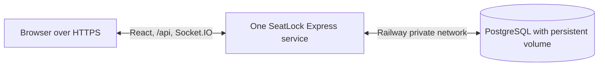

# SeatLock deployment preparation

This guide describes the existing Railway deployment configuration. The repository does not create cloud resources or configure billing. Booking confirmation remains a **demo with no payment charged**.

## Recommended architecture

Use one Railway application service and one Railway PostgreSQL service in the same project and region. Build the React app, then let Express serve `frontend/dist` together with `/api` and Socket.IO on one HTTPS origin. Keep PostgreSQL on Railway's private network; do not give it a public TCP proxy unless an external administration task requires one. Start with **one application replica**. Multiple Socket.IO replicas need a distributed adapter, and the process-local authentication rate limits need shared storage.

Railway's [PostgreSQL guide](https://docs.railway.com/databases/postgresql) describes its database service and private connection variables. Its [private networking guide](https://docs.railway.com/networking/private-networking) describes the encrypted service network. Review the current [pricing](https://docs.railway.com/pricing/plans) and resource limits before creating anything; even a small app and persistent database can incur usage or subscription costs.

## Proposed Railway service setup

These are instructions for a future deployment, not actions already performed.

1. Create a Railway project only after approving its current costs. Add a PostgreSQL service with persistent storage and an application service connected to this GitHub repository.
2. Set the application service root directory to `/` so both `backend` and `frontend` are available. Use **one** app replica. Do not expose the database publicly.
3. The checked-in [`railway.json`](../railway.json) specifies:

   | Stage | Command or path |
   | --- | --- |
   | Build | `npm run build:deploy` |
   | Pre-deploy | `node backend/dist/migrate.js`, then `node backend/dist/seed.js` |
   | Start | `npm run start:deploy` |
   | Health check | `/api/health` |

   `build:deploy` installs the backend and frontend lockfile dependencies and builds both. The pre-deploy commands use the built JavaScript, run before the new app starts, and must succeed when Railway loads this config. Startup also applies the same versioned migrations and, when `DEMO_MODE=true`, the idempotent fictional seed. This protects fresh databases when a pre-deploy step was not configured or was skipped; it does not replace checking the pre-deploy logs. Migrations run in numbered transactions with a transaction-scoped PostgreSQL advisory lock, so overlapping starts cannot apply the same version concurrently. Review schema changes and take a database backup before a deployment that adds a migration.

4. Assign an HTTPS domain to the application service. Set `FRONTEND_ORIGIN` to **that exact origin** (scheme and host, plus port only if nonstandard). Do not include a trailing slash or path. The production server refuses to start with an HTTP origin or a missing origin.
5. Configure Railway service variables. Use a reference to the PostgreSQL service's private `DATABASE_URL`, for example `${{Postgres.DATABASE_URL}}` when the database service is named `Postgres`. Do not paste a connection string into GitHub or commit an `.env` file. Railway documents [reference variables](https://docs.railway.com/variables).
6. Keep the database and app in the same region. Set the app health-check path to `/api/health`; Railway uses its injected `PORT` for health checks. Railway's [health check](https://docs.railway.com/deployments/healthchecks) is a deployment gate, not continuous monitoring.

### Application environment variables

| Name | Required in the future deployment | Purpose |
| --- | --- | --- |
| `DATABASE_URL` | Yes | Private PostgreSQL URL supplied by a Railway service reference |
| `NODE_ENV` | Yes: `production` | Enables static asset serving, one-hop proxy trust, and Secure cookies |
| `FRONTEND_ORIGIN` | Yes | Exact HTTPS public origin for CORS, CSRF, and Socket.IO origin checks |
| `DEMO_MODE` | Yes for this portfolio demo: `true` | Show only future showtimes and refresh fictional schedule every six hours |
| `DATABASE_SSL_MODE` | Optional | `disable` for the encrypted Railway private network, or `verify-full` with a trusted CA where end-to-end PostgreSQL TLS is required |
| `DATABASE_CA_CERT` | Only for a custom CA | PEM CA certificate text for `verify-full`; keep it in service variables |
| `PORT` | Provider-supplied | Express listens on the assigned port; do not hardcode a Railway port |

For local development, `.env.example` documents placeholders. The real `.env` is ignored. Do not put these values in `VITE_*` variables: Vite embeds those in browser assets.

The private Railway network is encrypted with WireGuard. The app's `DATABASE_SSL_MODE=disable` leaves PostgreSQL TLS off on that private hop; use `verify-full` and a valid server certificate/CA if policy requires PostgreSQL TLS as well. The `pg` driver can use a CA supplied through `DATABASE_CA_CERT`. If you set `DATABASE_SSL_MODE`, do not also put `sslmode`, `sslcert`, `sslkey`, or `sslrootcert` in `DATABASE_URL` because node-postgres may override SSL settings from the URL ([node-postgres SSL documentation](https://node-postgres.com/features/ssl)). Do not use `rejectUnauthorized: false`.

### HTTPS, cookies, and proxy

The browser uses one HTTPS origin for static files, API calls, and WebSockets. In production, the session cookie is `HttpOnly`, `Secure`, `SameSite=Lax`, scoped to `/api`, and backed by hashed session tokens in PostgreSQL. State-changing routes require the configured `Origin` and `X-SeatLock-Request: 1`. Socket.IO allows only the configured origin. Express trusts **one** reverse-proxy hop in production; verify the provider's proxy chain before a live launch. Never rely on a browser countdown or Socket.IO notice for booking ownership: PostgreSQL transactions and constraints remain authoritative.

## Demo data and schedule

`node backend/dist/seed.js` adds four fictional movies, physical seats, and two future UTC days of showtimes with deterministic `demo-...` IDs. Rerunning it does not duplicate existing rows. With `DEMO_MODE=true`, startup applies migrations and seeds the fictional catalog before accepting traffic; a six-hour timer keeps two future days populated. The API omits started showtimes from the demo catalog. Historical showtimes and bookings remain stored. No cleanup task or destructive update is involved.

The seed is intended **only** for this fictional portfolio demonstration. Do not run it against a database containing a real cinema catalog. To check rolling behavior locally without changing the existing development database, use a separately named disposable PostgreSQL database.

## Railway startup troubleshooting

The first attempted Railway startup reported PostgreSQL code `42P01` (missing table). A second attempt after adding only `npm run migrate --prefix backend` in the dashboard reported a generic `Error`. Both failures were reproduced locally: a fresh database reached the demo schedule query before tables existed; a migrations-only database then lacked the demo auditoriums. The current startup sequence checks connectivity, applies migrations, seeds when `DEMO_MODE=true`, attaches Socket.IO, and starts HTTP. If it fails, the log identifies the stage, error type, redacted message, PostgreSQL code, and a few stack frames. It does not print the connection string.

The checked-in `railway.json` already declares **both** migration and seed commands. [Railway's config-as-code reference](https://docs.railway.com/config-as-code/reference) says code settings override dashboard settings when that file is loaded. Inspect the failed deployment's **effective settings** and pre-deploy logs to establish whether Railway read `/railway.json`, ran both commands, and used the repository root (`/`) as the service root directory. The dashboard's migration-only command does not seed. If a command is needed in the dashboard, prefer the built JavaScript commands shown above; `npm run migrate --prefix backend` recompiles TypeScript and depends on build tools being present in the runtime image. [Railway pre-deploy commands](https://docs.railway.com/deployments/pre-deploy-command) run in a separate container with service variables and private-network access, and a failure should stop the deployment.

Do not paste the `DATABASE_URL` value into logs or issues. Confirm only that it references the intended private PostgreSQL service, that `NODE_ENV=production`, `DEMO_MODE=true`, and that `FRONTEND_ORIGIN` is exactly the HTTPS public origin. An "Online" database badge alone does not establish that the app is using its database. A `42P01` from the seed stage does show that PostgreSQL accepted a connection. If the new startup still fails, share the **redacted** startup stage/message/code/stack and the nonsecret effective build, pre-deploy, start, root-directory, and config-file settings.

## Backup, restore, and rollback

Enable Railway's [volume backups](https://docs.railway.com/volumes/backups) before a live demo and verify that a backup can be restored to a **separate** service or environment. Railway documents daily, weekly, and monthly backup schedules and a restore flow that creates a fresh volume; confirm the current retention and cost settings in the dashboard. Keep the PostgreSQL service private. For an independent logical backup, use `pg_dump` from a trusted environment with a temporary private connection; store the dump encrypted outside the repository. Never print credentials or commit dumps.

Recovery procedure:

1. Stop public booking traffic if data integrity is in doubt. Record the current app commit and database migration versions.
2. Restore a known-good backup to a **new** database service or volume. Do not overwrite the original database as the first step.
3. Validate `schema_migrations`, movie counts, seat claims, confirmed booking uniqueness, and `/api/health` against the restored copy.
4. Point a staging app at that copy and run API, auth, booking, and Socket.IO checks. Only then switch the application database reference and reopen traffic.

For a code-only regression, use Railway's deployment rollback to a known-good image, subject to its image retention policy ([deployment actions](https://docs.railway.com/deployments/deployment-actions)). SQL migrations are forward-only; rolling back application code does **not** roll back the database schema. Review compatibility before switching versions. Never run a destructive down migration or restore over live data without a separate decision and backup.

## Verification and operations after a future deployment

Before sharing a public URL, check:

- HTTPS redirects and valid certificate; Secure session cookie after registration; reload keeps the session; logout invalidates it.
- `/api/health` returns 200 with `database: connected`; `/api/movies` contains the four fictional films and future showtimes.
- Movie details, seat layout, hold, release, demo confirmation, and account history work for two independent browsers.
- A second browser receives hold, release, and booking changes, and an expired hold becomes available after reconciliation.
- Unknown API routes return JSON 404; browser routes `/`, `/login`, `/signup`, and `/account` load the React app.
- No real payment is charged, and no private data or secrets appear in browser bundles, public events, or logs.

Use Railway's [deploy/build logs and Log Explorer](https://docs.railway.com/observability/logs) to investigate startup failures, migration errors, database outages, and restarts. Application errors log a category and database error code rather than query values or connection strings. Check PostgreSQL volume usage and backup status. Railway's deployment health check is not continuous monitoring; add a separate uptime check if availability matters.

## Local verification without cloud resources

Run typechecks, builds, and the test suite from the repository root. `npm run build:deploy` reproduces the build commands expected on Railway. To smoke-test static serving locally, use a **separate test database** or keep `DEMO_MODE=false`, set `NODE_ENV=production`, set `FRONTEND_ORIGIN` to a placeholder HTTPS origin, and choose an unused `PORT`. Fetch `/`, `/login`, `/api/health`, and a built `/assets/...` file. A plain HTTP localhost test cannot verify browser delivery of a Secure cookie; that requires a real HTTPS endpoint or a local TLS proxy.

The existing Vite workflow remains available through `npm run dev`; it continues to proxy `/api` and `/socket.io` to the backend. The browser E2E suite starts dedicated local dev servers and uses isolated fixtures.

**Local preparation verification on 2026-11-13:** `npm run build:deploy` and both TypeScript checks passed. Against a disposable PostgreSQL database, migrations 001–003 applied, two seed runs each left 26 rolling showtimes, API tests passed 4/4, authentication 9/9, booking 8/8, real-time 5/5, and Edge browser 2/2. A production-mode local HTTP smoke test returned 200 for the homepage, login page, built asset, and health endpoint; all 12 Afterlight showtimes returned by the demo API were future-dated; registration set `Secure`, `HttpOnly`, and `SameSite=Lax`; a wrong origin returned 403; unknown API returned 404; and a Socket.IO client joined a showtime room. The disposable database was removed afterward. Public HTTPS and Railway deployment have **not** been tested.

**Railway startup fix verification on 2026-11-13:** A clean disposable database reproduced `42P01`; applying migrations alone reproduced the generic `Error`. With the startup fix, a separate empty database automatically applied all three migrations, seeded four fictional movies and 26 rolling showtimes, and returned a connected `/api/health`. Seed reruns kept those counts unchanged. Backend and frontend typechecks, production build, API 4/4, auth 9/9, booking 8/8 (including 20 parallel contenders), real-time 5/5, and diagnostic redaction 1/1 passed locally. Both disposable databases were removed. This does not verify Railway's effective settings or a successful public HTTPS deployment.

## Known limits and costs

A Railway deployment has been attempted but has not been verified healthy over public HTTPS. Railway's plan terms, usage, volume, network egress, backup, and optional paid features can change; inspect the [current pricing](https://docs.railway.com/pricing/plans) before deployment. The default PostgreSQL service is a single node; high availability, backups, and point-in-time recovery require deliberate configuration. The app is prepared for one backend instance. Scaling out requires a distributed Socket.IO adapter and shared rate limiting. This portfolio demo has no real payments, refunds, ticket scanning, email verification, or production operations runbook beyond this preparation guide.
